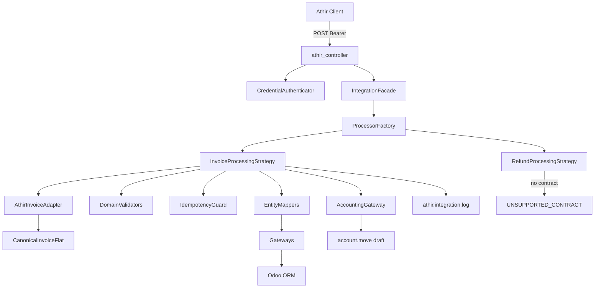

# Athir Integration (`bh_athir_integration`)

Inbound Athir flat invoices → **draft** Odoo customer invoices (`account.move`, `out_invoice`).

Author: AlMajal Tech · License: LGPL-3 · Odoo 19

## Architecture



### Boundaries

| Layer | Owns |
|---|---|
| **External (Athir wire)** | Field names / shape sent by Athir. Adapter is the **only** place that knows them. |
| **Canonical (flat)** | Invoice-level `organization`, `mrn` / `insurance_company_*`, `branch_*`, `clinic_*`, `cashier_*`; line-level `service_*`, `doctor_*`, `service_group_*`, `tax_code_id`; payment `pay_method_id`. |
| **Odoo** | Mapped `res.company` / `res.partner` / products / taxes and draft `account.move` audit fields. |

Until a verified Athir wire sample exists, the adapter accepts the agreed **flat** shape as the working external input (identity map into canonical). Nested invented shapes are not supported.

## Endpoints

| Route | Auth | Behavior |
|---|---|---|
| `POST /api/athir/v1/invoices` | Bearer / `X-API-Key` | Adapt → validate → idempotency → resolve → create **draft** invoice |
| `POST /api/athir/v1/refunds` | Bearer / `X-API-Key` | Returns `501` `UNSUPPORTED_CONTRACT` — creates nothing |

Error envelope:

```json
{
  "success": false,
  "error": {"code": "UNRESOLVED_CUSTOMER", "message": "...", "details": {}},
  "correlation_id": "..."
}
```

## Authentication

1. Open **Athir → Configuration → API Credentials**.
2. Create a credential (optionally scoped to a company).
3. Click **Generate Token** and copy the token (shown once).
4. Call the API with `Authorization: Bearer <token>` or `X-API-Key: <token>`.

Tokens are stored as SHA-256 hashes only. Revoke from the form when needed.

## External mapping

**Athir → Configuration → External Mappings**

| entity_type | Typical Odoo model | Notes |
|---|---|---|
| `company` | `res.company` | Maps Athir `organization` string → company. **Required** (no safe default). |
| `product` | `product.product` | Maps `service_id` → product |
| `tax` | `account.tax` | Mapping only — never fuzzy-match `"15%"` |
| `customer` | `res.partner` | Optional if B2C `athir_mrn` / B2B `athir_insurance_company_id` is set |
| `payment_method` | `account.payment.method` | Optional; traces always stored |
| branch / clinic / doctor / cashier / service_group | any | Optional link; external id/name always audited on the move/lines |

**v1 policy:** missing or ambiguous → reject. **No auto-create.**

### Customers

- **B2C:** require `mrn`; resolve by mapping or unique `res.partner.athir_mrn`
- **B2B:** require `insurance_company_id`; resolve by mapping or unique `res.partner.athir_insurance_company_id`
- `organization` is **not** the invoice customer

## Idempotency

`athir.processed.document` unique on `(source_system, operation, external_id)` plus `pg_advisory_xact_lock`.

| Prior state | Same payload hash | Different hash |
|---|---|---|
| succeeded | `already_processed` | `IDEMPOTENCY_CONFLICT` |
| failed | retry allowed | retry allowed |

Also `UNIQUE(athir_source_system, athir_invoice_id, company_id)` on `account.move`.

## Draft-only accounting policy

- Creates `out_invoice` in **draft** only
- Never calls `action_post()` or payment registration in v1
- Line `price_unit` = Athir `price`; `discount_amount` → Odoo `%`
- Compares Odoo `amount_total` to Athir `total_amount` within company tolerance (default `0.01`)
- On mismatch → `FINANCIAL_DISCREPANCY` and rollback (savepoint)
- `pay_methods` stored on `athir.invoice.payment.trace` only

Settings (Invoicing settings → Athir Integration):

- Financial tolerance
- Allow default company fallback (**off**)
- Store raw payloads (**off** — patient data risk)
- Auto-post / register payments flags exist but are **unused** in v1

## Refund extension checklist

When Athir publishes a refund contract:

1. Define payload + stable `refund_id` and original `invoice_id`
2. Implement `AthirRefundAdapter.adapt`
3. Implement `RefundProcessingStrategy` using `_reverse_moves()` → `out_refund`
4. Separate idempotency key `(source, refund, refund_id)`
5. Keep draft-or-post policy explicit

## Install / test

```bash
# add athier/ to addons_path, then:
./odoo-bin -d <db> -i bh_athir_integration --stop-after-init

./odoo-bin -d <db> --test-enable --stop-after-init \
  -i bh_athir_integration \
  --test-tags=/bh_athir_integration
```

## Flat payload shape (working contract)

Field names must be verified against a **real Athir wire sample** before production. Until then, external input matches the canonical flat grouping.

```json
{
  "invoice_id": "ATH-INV-1001",
  "bill_type": "B2C",
  "organization": "ORG-1",
  "branch_id": "BR-1",
  "branch_name": "Main",
  "clinic_id": "CL-1",
  "clinic_name": "Dental",
  "cashier_id": "CA-1",
  "cashier_name": "Cashier",
  "mrn": "MRN-100",
  "total_amount": 115.0,
  "services": [
    {
      "service_id": "SVC-1",
      "service_name": "Consultation",
      "service_group_id": "SG-1",
      "service_group_name": "OPD",
      "doctor_id": "DOC-1",
      "doctor_name": "Dr Smith",
      "price": 100.0,
      "discount_amount": 0.0,
      "net_price": 100.0,
      "tax_code_id": "TAX-15",
      "insurance_net_without_vat": 0.0,
      "insurance_vat_amount": 0.0,
      "cash_net_without_vat": 100.0,
      "cash_vat_amount": 15.0,
      "transaction_created_at": "2026-01-15T10:00:00"
    }
  ],
  "pay_methods": [{"pay_method_id": "CASH", "amount": 115.0}]
}
```

B2B replaces `mrn` with:

```json
"insurance_company_id": "INS-1",
"insurance_company_name": "Bupa"
```

`transaction_created_at` accepts ISO datetime or date-only (`YYYY-MM-DD`). `pay_method_id` accepts string or integer (normalized to string).

## Error codes (stable)

| Code | Meaning |
|---|---|
| `UNAUTHORIZED` | Missing/invalid/revoked token |
| `VALIDATION_ERROR` / `MISSING_*` / `INVALID_*` | Payload problems |
| `UNRESOLVED_*` | Mapping miss |
| `AMBIGUOUS_MAPPING` | Multiple matches |
| `IDEMPOTENCY_CONFLICT` | Same id, different payload |
| `FINANCIAL_DISCREPANCY` | Totals/net mismatch |
| `UNSUPPORTED_CONTRACT` | Refunds (v1) |
| `INTERNAL_ERROR` | Unexpected failure |

## Remaining external-contract uncertainties

1. **Verified Athir wire JSON sample** still missing — production wire may differ from this flat shape; adapter owns translation if/when confirmed.
2. Whether `organization` is a stable **id** or a **display name** (e.g. `"Testing Medical Center"`); mapping keys off the string value as `entity_type=company` external id.
3. Whether `tax_code_id` like `"15%"` is a stable external code (mapping-only; no fuzzy match).
4. Whether `transaction_created_at` is date-only vs datetime in production (adapter accepts both).
5. Refund payload still unsupported.
